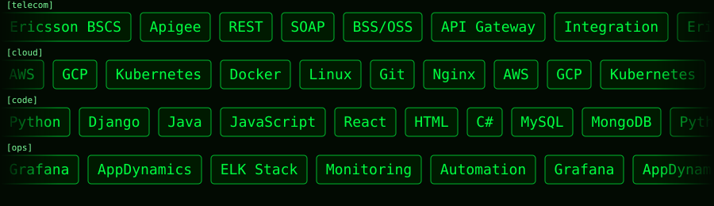

<p align="center">
  
</p>

<p align="center">
  <a href="https://github.com/Mohammed12Khair">
    
  </a>
</p>

<p align="center">
  
  
</p>

---

### `> cat about.txt`

```bash
$ whoami
mohammed_khair

$ cat /etc/profile
role       : Telecommunications & IT Specialist (8+ yrs)
domain     : BSS/OSS | Ericsson BSCS | Apigee | System Integration
interests  : Cloud Architecture, AWS, Kubernetes, DevOps
exploring  : AI, LLM integrations, intelligent automation
mission    : Build scalable systems & automate everything

$ status
[OK] always learning  [OK] always building  [OK] always improving
```

### `> ls ~/arsenal`

<p align="center">
  
</p>

---

### `> ./stats.sh`

<div align="center">


</div>

---

### `> ssh connect@linkedin`

<p align="center">
<a href="https://www.linkedin.com/in/mohammedkhairtarig/">

</a>
</p>

<p align="center">
  
</p>
